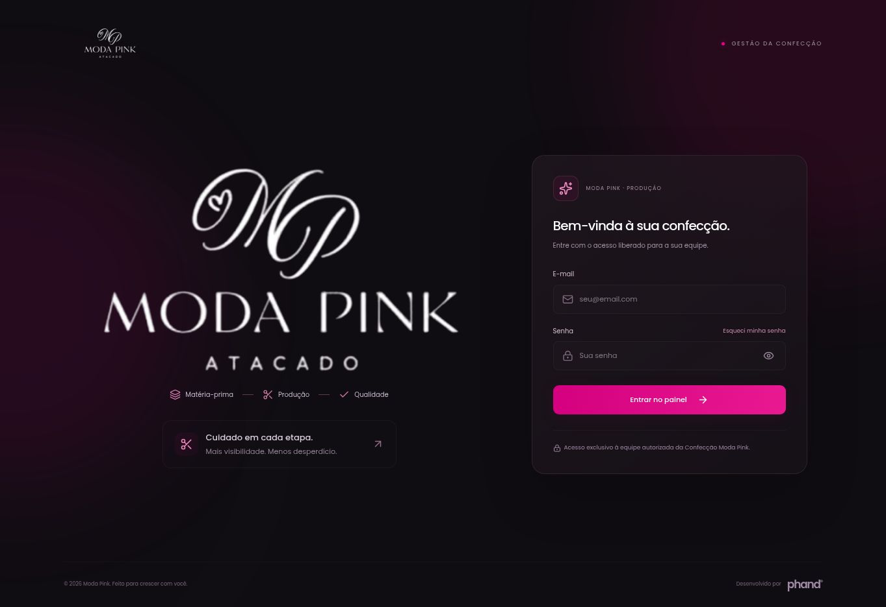

# Moda Pink · Gestão da Confecção

Aplicação independente em Next.js App Router, TypeScript e Tailwind CSS 4. Identidade Moda Pink: Poppins local, login escuro e dashboard clara com pink #e70289.

## Situação da integração

Endereço oficial: [https://modapink-confeccao.vercel.app](https://modapink-confeccao.vercel.app). A versão corrigida foi publicada em produção na Vercel. O Site anterior no ChatGPT foi excluído, e seus callbacks foram removidos do Supabase.

Banco instalado no projeto `ragyjbrbhfataoiosgqy` (Confeccção), organização Confeccção Moda Pink. Migrações aplicadas: núcleo operacional, hardening, portal, convites, correção de metadados de imagens e exclusão segura. São 17 tabelas da aplicação: `profiles` em `public` e as demais em `mf_private`. Todas as tabelas da aplicação usam RLS, e as imagens ficam no bucket privado `confeccao-images`.

A aplicação usa configuração pública do projeto na hospedagem, sem chaves administrativas no cliente. O Auth por e-mail/senha está configurado para a Vercel: Site URL `https://modapink-confeccao.vercel.app`, redirects exatos `https://modapink-confeccao.vercel.app/auth/recovery` e `https://modapink-confeccao.vercel.app/auth/confirm`, e cadastro público desativado. O callback antigo do ChatGPT foi removido da lista autorizada. O endpoint de configurações confirmou `disable_signup: true` e `external.email: true`.

O SMTP personalizado Resend está configurado e sua persistência foi confirmada após recarregar o painel. Há uma identidade Auth criada por convite, com e-mail confirmado e senha pessoal definida, e um perfil administrador ativo. O convite foi enviado em `2026-10-31T23:46:57.288Z` e o Resend confirmou sua entrega. O e-mail da destinatária não é persistido neste repositório. O bootstrap administrativo já foi executado e verificado: há exatamente um administrador ativo. Não repetir o bootstrap. Resta validar o fluxo completo da aplicação com sessão autenticada, incluindo as imagens privadas. Nenhum usuário ou senha padrão foi inventado.

O template de convite do Supabase está em português, usa `{{ .ConfirmationURL }}` e tem sua cópia em [supabase/email-templates/invite.html](supabase/email-templates/invite.html). O assunto enviado foi “Crie sua senha — Confecção Moda Pink”. O recibo sem destinatário está em `supabase/deployment-status.json`.


## Execução

Requer Node.js 22.13 ou superior.

```sh
cd projects/confeccao
npm ci
cp .env.example .env.local
# Preencher a URL e a chave PUBLICÁVEL do projeto correto.
npm run dev
```

Configuração pública necessária:

```env
NEXT_PUBLIC_SUPABASE_URL=
NEXT_PUBLIC_SUPABASE_PUBLISHABLE_KEY=
```

Somente chaves `sb_publishable_...` são aceitas no cliente. Nunca usar chave administrativa no frontend. Sem configuração válida, o aplicativo informa que a conexão está pendente e não abre dados demonstrativos como se fossem reais.

## Funcionalidades preparadas

- Login por e-mail/senha, encerramento de sessão e recuperação de senha com destino fixo.
- Callback de convite em `/auth/confirm` implementado; convite entregue, e-mail confirmado e primeira senha definida, com estados verificados no Auth.
- Perfis ativos: administração, gestão, produção e qualidade, com autorização efetiva no banco.
- Materiais e fichas por lote, reservas e consumo real em comandos transacionais.
- Ordens em lista ou quadro, quantidades por tamanho e bloqueio de conclusão sem qualidade.
- Aprovação, retrabalho, reconferência e perdas sem dupla contagem.
- Custos históricos por snapshots imutáveis e acesso financeiro restrito.
- Dashboard com aprovações por data registradas no banco, sem distribuição fictícia.
- Confecções parceiras com atribuição de ordens, portal de apontamentos e acompanhamento na dashboard.
- Imagens em bucket privado, com URLs temporárias na leitura e limite de 5 MB.
- Controle de revisão e chaves idempotentes para impedir duplicidades em tentativas repetidas.
- Estados de fábrica vazia; nenhum exemplo é importado automaticamente para produção.

## Confecções parceiras e portal

Na página **Confecções parceiras** (`/confeccoes`), administração e gestão podem:

1. Cadastrar a confecção, com nome e contato opcional.
2. No cartão da confecção, clicar em **Vincular produção** e escolher uma ordem aberta. Cada ordem fica visível para uma confecção por vez.
3. Gerar o acesso e copiar o link exibido. Ele aparece uma única vez, vale por **30 dias** e deve ser compartilhado apenas com a confecção responsável. Gerar outro link revoga o anterior; o acesso também pode ser revogado pela página.

A parceira abre o link em `/portal-confeccao` e consulta somente suas ordens atribuídas. Pode informar nome do responsável, etapa e totais acumulados de peças produzidas, conferidas e com defeito, além de observações. As fotos são opcionais e ficam em armazenamento privado. Quando houver defeitos, a descrição é obrigatória.

Produção e qualidade também podem acompanhar os relatos na página interna, na dashboard e no detalhe da OP. O andamento é atualizado a cada 15 segundos enquanto a página está visível, ao retornar à janela ou pelo botão **Atualizar**. O histórico recente preserva o último apontamento de cada confecção; os totais acumulados não devem ser somados entre envios.

**Os apontamentos externos aguardam conferência interna:** não movimentam estoque, não alteram a qualidade oficial e não concluem a OP. A conferência e a liberação das peças continuam na Moda Pink.

## Verificação local

```sh
npm run typecheck
npm test
npm --prefix supabase/tests ci
npm run test:db
npm run build
```

TypeScript, build, 56 testes locais de domínio/callback/portal/equipe/materiais/qualidade e os testes PostgreSQL passaram. Next.js 16.4.3 e Zod 4.6.7 estão fixados; a auditoria npm não encontrou vulnerabilidades em produção ou desenvolvimento. A publicação Vercel está READY e o login respondeu HTTP 200 com a configuração pública do Supabase correto. O painel redireciona visitantes sem sessão ao login. A confirmação do e-mail, a definição da senha e o perfil administrador ativo foram verificados no banco; o teste completo no navegador com sessão autenticada e upload/leitura privada permanece pendente.

Os testes SQL usam PostgreSQL embarcado com Auth/Storage sintéticos, sem conexão à operação da cliente. Verificam atomicidade, reservas, concorrência, replay, qualidade, snapshots, contrato de retorno, RLS e permissões. Não substituem os testes reais de Auth, entrega de e-mail e upload/download após liberar o projeto.

## Ativação no projeto correto

Consulte [supabase/README.md](supabase/README.md) para os registros da instalação e a validação restante. O banco já foi aplicado; não executar `schema.sql` novamente sobre a estrutura existente. O bootstrap da primeira administradora já foi concluído e não deve ser repetido. O cadastro público já está desativado e deve permanecer assim. As contas serão individuais, com e-mails fornecidos e confirmados pela responsável. O bootstrap não promove o primeiro visitante nem cria senhas padrão.

Em **Configurações → Cadastrar pessoa**, a administração informa nome, e-mail e perfil. A função de servidor `team-access` cria o convite Auth e libera o perfil autorizado. Cada pessoa define a própria senha pelo e-mail. A lista mostra convite pendente, senha pendente, acesso ativo ou desativado; permite editar permissões, reenviar convite ou solicitar recuperação. Não há senha padrão nem criação de contas pelo navegador. Os nomes dos perfis de permissão não são logins compartilhados.

A pasta mantém build e dependências próprios; o TypeScript da raiz a exclui do painel existente.

## Interface e equipe

O login destaca o logo da Moda Pink e preserva Matéria-prima, Produção, Qualidade e Cuidado em cada etapa. Poppins é aplicada ao sistema e aos campos. A visão geral mostra a etapa e o próximo passo de cada lote, incluindo planejados. No detalhe da produção, a ação seguinte explica consumo de tecido e conferência necessária. O portal apresenta etapas em botões explicados e um exemplo de contagem acumulada.

Convites exigem administração ativa no servidor; gestão pode consultar a equipe. O endpoint valida o JWT no Auth, revalida a autorização no banco e aplica limite de 20 solicitações por hora e intervalo de 60 segundos por destinatário. Uma solicitação incerta pode ser retomada sem duplicar o e-mail. Nenhum link de login ou senha é devolvido ao administrador. O template de recuperação em português fica em `supabase/email-templates/recovery.html`.



## Exclusão e campos de materiais

Administração e gestão podem excluir materiais, fichas, produções e confecções; somente administração exclui integrantes da equipe. A ação pede confirmação pelo nome, retira o cadastro das listas, busca e seletores e preserva histórico relacionado. Produções excluídas liberam somente reservas pendentes, uma única vez; tecido consumido não é devolvido automaticamente ao estoque. A própria conta e o último administrador são protegidos. Confecções removidas têm seus links revogados.

Cadastros removidos podem ser refeitos com a mesma identificação. Para e-mail da equipe, um novo convite explícito pode readicionar a pessoa; solicitações antigas não reativam o acesso. Referências históricas podem permanecer nos dados de uma OP existente, sem reaparecer no catálogo nem permitir novos usos.

Materiais mostram a unidade dos saldos, custo com R$ e exemplo de vírgula decimal. Os ícones de informação funcionam por mouse, foco e toque. Saldo inicial é o que já existe no lote; saldo mínimo é o limite de reposição, descontadas as reservas.

O portal passou a autorizar a operação de metadados necessária ao download privado. Falha em uma foto gera aviso separado após revalidar o acesso, sem derrubar o lote autorizado. Revogação ou falha de autorização continuam bloqueando a consulta.

## Navegação, custos e qualidade

O menu segue a preparação da operação: visão geral, materiais, fichas, ordens de produção, confecções parceiras, qualidade e custos. As ações de exclusão nas listas e cartões usam somente a lixeira, com identificação acessível; a confirmação continua explícita.

Custos mostra previsto, tecido apurado mais serviços da ficha, diferenças entre os mesmos lotes e custo por peça aprovada. Filtro e busca acompanham indicadores, tabela e CSV; os lotes sem consumo ficam aguardando apuração. O destaque pink mostra aproveitamento real dos concluídos, sem efeitos circulares. Não calcula preço de venda ou lucro.

Registrar conferência segue três passos: escolher o lote, informar um resultado e revisar antes de gravar. Mostra grade e contadores, explica aprovadas/conserto/perda, exige quantidade inteira disponível e descrição para Outro. Uma confirmação salva um único resultado. A reconferência confirma as peças antes de liberar o retrabalho.

Os templates de convite e recuperação foram atualizados no Supabase com logo PNG público, cabeçalho escuro, botão pink e identidade Moda Pink. HTML em português com tabelas, estilos inline, texto alternativo e link de confirmação preservado. Nenhum novo e-mail real foi enviado durante a preparação do visual.

## Formação de preço

A aba `/precificacao`, exclusiva para administração e gestão, cria e salva simulações independentes. Importa uma cópia da ficha ou OP (com snapshot das tarifas e consumo real, quando disponível) e aceita custos por peça produzida, por lote ou mensais. Despesas mensais são rateadas pelo volume mensal de peças vendáveis. A quantidade vendável absorve as perdas do lote sem acrescentá-las novamente. Os grupos incluem materiais, desenvolvimento, produção, logística e estrutura; há gastos extras editáveis e oito tipos de taxas percentuais sobre a venda.

O preço calculado usa custo por peça dividido por `1 − taxas − margem`. Também mostra o mínimo para os custos informados, o efeito do preço de atacado praticado e a revenda calculada com margem, despesas percentuais e gasto adicional da lojista. Não preenche alíquotas fiscais ou margens comerciais como recomendações. A exportação CSV preserva as premissas. Simulações podem ser abertas, editadas e excluídas com confirmação; o banco protege versões concorrentes e tentativas repetidas e não reativa registros removidos. Nenhuma ação muda estoque, ficha ou OP.

Instalação: após `supabase/record-removal.sql`, aplicar `supabase/migrations/20261101020350_create_pricing_sheets.sql`. A tabela fica privada com RLS, sem acesso direto; os três RPCs revalidam perfil financeiro ativo. A nova suíte `npm --prefix supabase/tests run test:pricing` usa PostgreSQL local com dados sintéticos.
