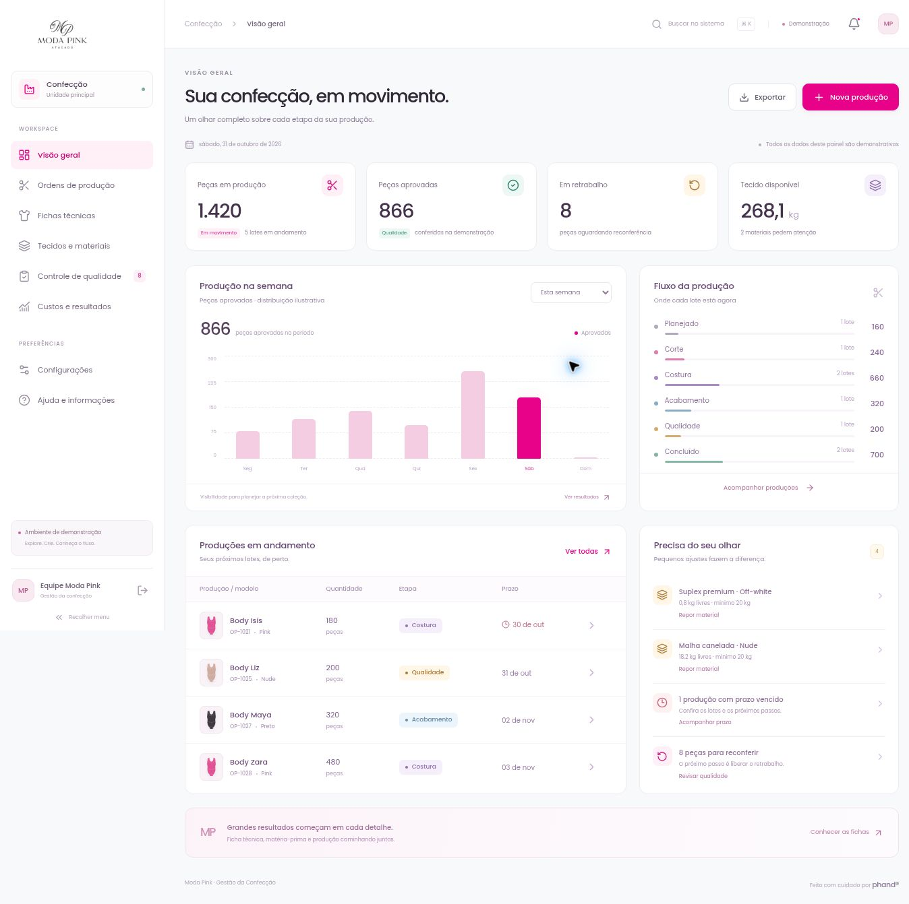

# Moda Pink · Gestão da Confecção

Aplicação independente em Next.js App Router, TypeScript e Tailwind CSS 4. Identidade Moda Pink: Poppins local, login escuro e dashboard clara com pink #e70289.

## Situação da integração

Banco instalado no projeto `ragyjbrbhfataoiosgqy` (Confeccção), organização Confeccção Moda Pink. Migrações aplicadas: estrutura operacional e restrição de execução de um helper privilegiado da plataforma. Todas as tabelas da aplicação usam RLS, e as imagens ficam no bucket privado `confeccao-images`.

A aplicação usa configuração pública do projeto na hospedagem, sem chaves administrativas no cliente. A ativação de usuários ainda depende dos e-mails individuais confirmados pela responsável; nenhum usuário, senha padrão ou convite foi inventado. Configuração de URLs do Auth/envio de e-mail e testes com uma conta real continuam pendentes da administração do Auth.



## Execução

Requer Node.js 22.13 ou superior.

```sh
cd projects/confeccao
npm ci
cp .env.example .env.local
# Preencher a URL e a chave PUBLICÁVEL do projeto correto.
npm run dev
```

Configuração pública necessária:

```env
NEXT_PUBLIC_SUPABASE_URL=
NEXT_PUBLIC_SUPABASE_PUBLISHABLE_KEY=
```

Somente chaves `sb_publishable_...` são aceitas no cliente. Nunca usar chave administrativa no frontend. Sem configuração válida, o aplicativo informa que a conexão está pendente e não abre dados demonstrativos como se fossem reais.

## Funcionalidades preparadas

- Login por e-mail/senha, encerramento de sessão e recuperação de senha com destino fixo.
- Perfis ativos: administração, gestão, produção e qualidade, com autorização efetiva no banco.
- Materiais e fichas por lote, reservas e consumo real em comandos transacionais.
- Ordens em lista ou quadro, quantidades por tamanho e bloqueio de conclusão sem qualidade.
- Aprovação, retrabalho, reconferência e perdas sem dupla contagem.
- Custos históricos por snapshots imutáveis e acesso financeiro restrito.
- Dashboard com aprovações por data registradas no banco, sem distribuição fictícia.
- Imagens em bucket privado, com URLs temporárias na leitura e limite de 5 MB.
- Controle de revisão e chaves idempotentes para impedir duplicidades em tentativas repetidas.
- Estados de fábrica vazia; nenhum exemplo é importado automaticamente para produção.

## Verificação local

```sh
npm run typecheck
npm test
npm --prefix supabase/tests ci
npm run test:db
npm run build
```

Os testes SQL usam PostgreSQL embarcado com Auth/Storage sintéticos, sem conexão à operação da cliente. Verificam atomicidade, reservas, concorrência, replay, qualidade, snapshots, contrato de retorno, RLS e permissões. Não substituem os testes reais de Auth, entrega de e-mail e upload/download após liberar o projeto.

## Ativação no projeto correto

Consulte [supabase/README.md](supabase/README.md) para inspecionar o projeto, aplicar `schema.sql`, executar advisors e configurar o Auth. Cadastro público deve permanecer desativado; contas são individuais, com e-mails fornecidos e confirmados pela responsável. O bootstrap não promove o primeiro visitante nem cria senhas padrão.

As configurações da interface administram perfis já provisionados. A criação de identidades Auth e os convites exigem o fluxo administrativo verificado no Supabase. Os nomes dos perfis de permissão não são logins compartilhados.

A pasta mantém build e dependências próprios; o TypeScript da raiz a exclui do painel existente.
